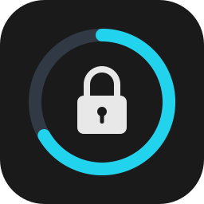
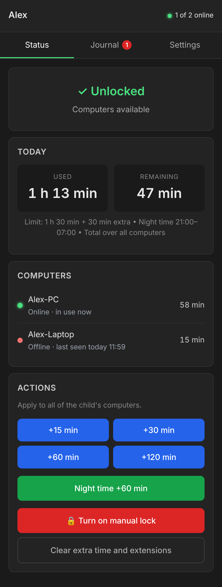
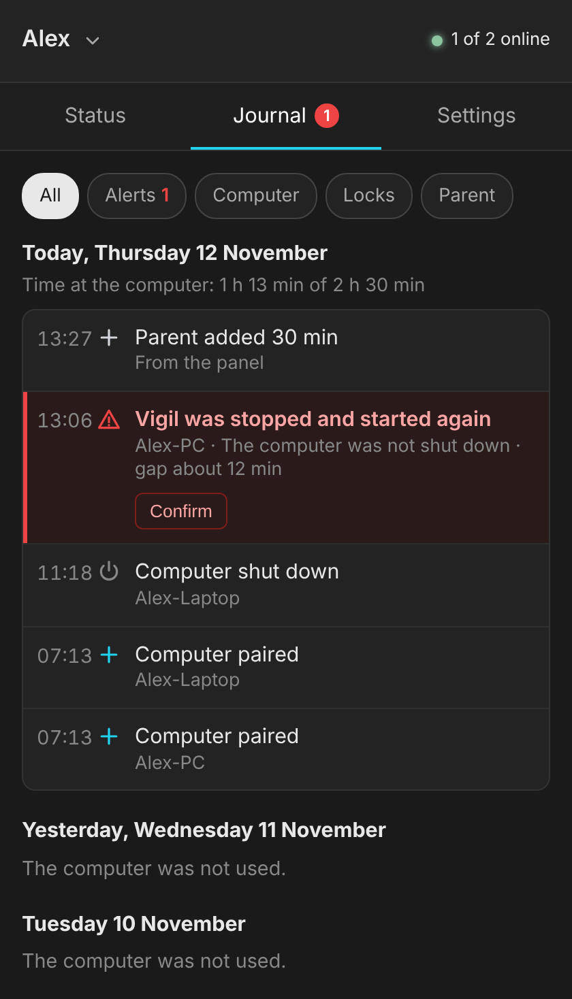
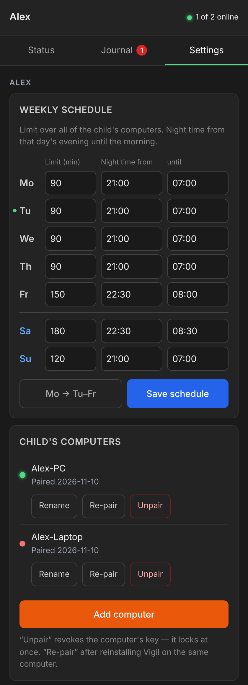
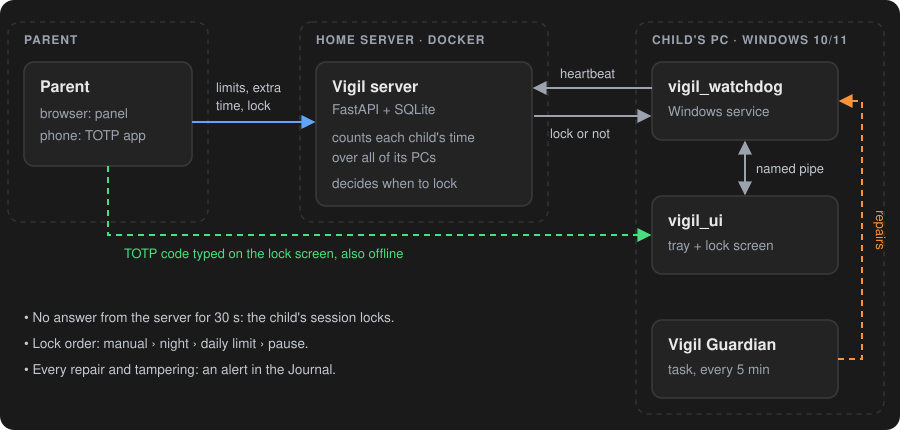
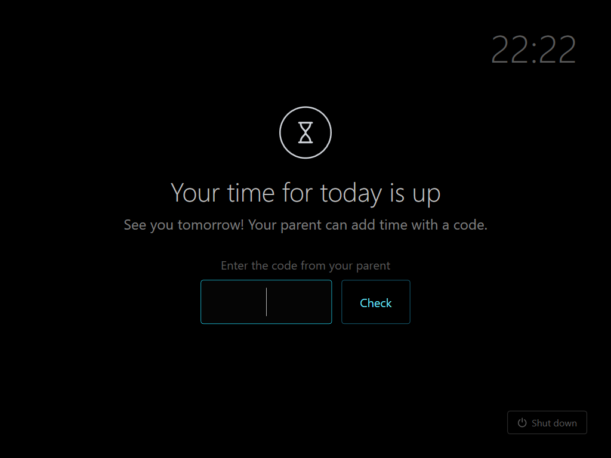
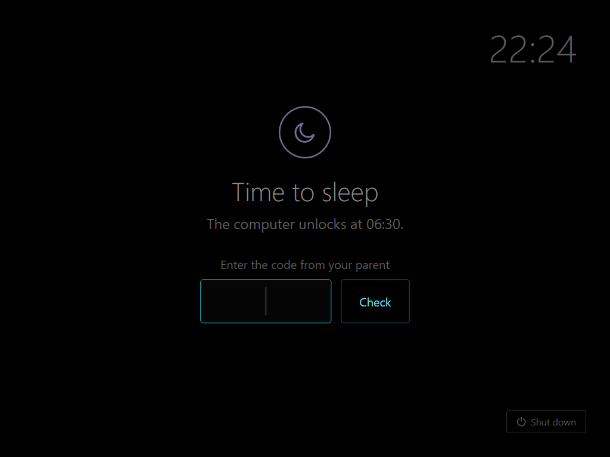

<p align="right">
  <b>English</b> · <a href="README.pl.md">Polski</a>
</p>

<p align="center">
  
</p>

<h1 align="center">Vigil</h1>

<p align="center">
  <b>Screen-time limits for a child's Windows PC, on your own server.</b><br>
  A daily limit and night time for each day of the week, a full-screen lock on the PC and a panel in your phone's
  browser. No cloud, no account, no subscription.
</p>

<p align="center">
  <a href="https://github.com/deresterr/vigil/releases/latest"></a>
  <a href="https://github.com/deresterr/vigil/actions/workflows/ci.yml"></a>
  <a href="LICENSE"></a>
</p>

<p align="center">
  <a href="#quick-start"><b>Quick start</b></a> ·
  <a href="https://github.com/deresterr/vigil/releases/latest"><b>Download</b></a> ·
  <a href="#how-it-works">How it works</a> ·
  <a href="docs/threat-model.md">Threat model</a>
</p>

<table align="center">
  <tr>
    <td align="center" valign="top" width="33%">
      <br>
      <sub><b>Status</b> — today's time, computers, extra time and the lock</sub>
    </td>
    <td align="center" valign="top" width="33%">
      <br>
      <sub><b>Journal</b> — what happened, with alerts to confirm</sub>
    </td>
    <td align="center" valign="top" width="33%">
      <br>
      <sub><b>Settings</b> — the week, children and their computers</sub>
    </td>
  </tr>
</table>

> [!NOTE]
> **Before 1.0, in daily use.** Give the child a standard account — the installer creates one — and Windows itself
> refuses what would switch Vigil off. A child with administrator rights can get around Vigil: it makes that harder
> and shows it to the parent, but does not make it impossible. See [what Vigil can and cannot stop](#what-vigil-can-and-cannot-stop).

## Features

**For the parent**

- A daily limit and night time for each day of the week, for each child
- Several children on one server, each with any number of PCs; a child's time counts across all of them
- Extra time or a lock in one tap from the panel, or with the code from your phone typed on the lock screen
- The code from your phone unlocks the PC even when the server is down
- A journal: when each PC was on, asleep or shut down, what you changed, and an alert whenever someone tried to
  get around Vigil

**For the child**

- A lock screen that says why the PC is locked and when it unlocks
- A pause: a click on the tray icon stops the clock and locks the screen until they are back

**On the PC**

- One file, `vigil_setup.exe`, to install, check, update, re-pair and uninstall
- Windows 10 and 11, Home or Pro; the child on a standard account (the installer creates one) or on the PC's
  only, administrator, account
- English or Polish, following the browser's and Windows' language

## Quick start

You need a Linux machine with Docker on the same network as the child's PC (or reachable over a VPN), and a TOTP
app on your phone (Aegis, Google Authenticator, …).

### 1. Start the server

In an empty folder, create `compose.yaml`:

```yaml
services:
  vigil:
    image: ghcr.io/deresterr/vigil-server:latest   # or a version, e.g. :0.9.1
    container_name: vigil
    restart: unless-stopped
    ports:
      - "8088:8088"
    volumes:
      - ./data:/data        # the SQLite database: keep it in your backups
```

```bash
docker compose up -d
```

### 2. Set it up in the browser

Open `http://<server-ip>:8088/setup` right after the start — until the wizard is completed, anyone on the network
can open it. It asks for the child's name, your panel password, the TOTP app (scan the QR code), the time zone and
the week: a limit and night time for each day. You can change the week later in **Settings → Weekly schedule**.

### 3. Install on the child's PC

1. In the panel, open **Settings → Add computer** to get a pairing code.
2. On the child's PC, download
   [`vigil_setup.exe`](https://github.com/deresterr/vigil/releases/latest/download/vigil_setup.exe) and run it.
   It asks for administrator rights; SmartScreen may first show "Windows protected your PC" (More info → Run
   anyway).
3. Type the server address and the pairing code. On a PC with one administrator account the installer offers to
   create a standard account for the child (recommended): yours stays the administrator and needs a password,
   which the installer sets if it has none. Nothing changes before you confirm the summary.
4. Sign out, and let the child sign in to their own account. Only its time counts.

Run `vigil_setup.exe` again at any time for the status and a menu: check, update, change the server address,
re-pair, uninstall. Parameters for scripts: [`docs/installer.md`](docs/installer.md).

## How it works

<p align="center">
  
</p>

- Every few seconds the service on the PC sends the server a signed heartbeat (every second while locked).
- The server counts the child's time across all of their PCs and decides whether to lock: manual lock, night
  time, daily limit or pause, in that order.
- The service shows or removes the lock screen in the child's session.
- **No answer from the server for 30 seconds means locked.** The code from your phone still unlocks the PC; once
  the server answers again, it decides, and the minutes used offline do not count.
- A guardian task puts back whatever keeps the service running, and every repair is an alert in the panel.

<table align="center">
  <tr>
    <td align="center" valign="top" width="50%">
      <br>
      <sub>The time for today is up: the parent can add time with a code</sub>
    </td>
    <td align="center" valign="top" width="50%">
      <br>
      <sub>Night time: the lock says when the PC unlocks</sub>
    </td>
  </tr>
</table>

Protocol, time accounting and file paths: [`docs/architecture.md`](docs/architecture.md).

## What Vigil can and cannot stop

Give the child a **standard account** of its own and keep an administrator account with a password for yourself:
Windows then refuses the child what would switch Vigil off, and only the child's sessions count. Vigil also works
with one administrator account the child and you share, but an administrator can disable any service and read any
file: what matters still lives on the server, the rest is only made hard to undo, and you see the attempts.

| | Standard account | One administrator account |
|---|---|---|
| Limits, night time, the lock and the time counter; one-time pairing codes; TOTP codes that work once | **Protects** — the state is on the server | **Protects** |
| Stopping the service, replacing its files, reading its key, closing the lock screen, setting the clock; locked without the server | **Protects** — Windows refuses it | **Impedes** — a guardian undoes tampering |
| A stopped, frozen or restarted service, a lock screen closed repeatedly, every repair by the guardian, an account that became an administrator, runs of wrong codes | **Detects** — an alert in the Journal | **Detects** |

**Not detected:** another system booted from a USB stick or Windows Recovery, a reset PC, a deleted configuration
— the panel shows the PC as offline — and the child using your session while it is unlocked. Against the first
ones: a firmware password, no booting from USB and Device encryption ([physical access](docs/threat-model.md#physical-access)).

> [!IMPORTANT]
> The server speaks plain HTTP, and the pairing and the panel login send their secrets unencrypted. On a network
> you do not trust, put a reverse proxy with TLS in front of it and set `FORWARDED_ALLOW_IPS` in `.env` to its
> address ([Network](docs/threat-model.md#network)).

Every mechanism, group by group: [`docs/threat-model.md`](docs/threat-model.md). What counts as a vulnerability:
[`SECURITY.md`](SECURITY.md).

## Updating

| | How to update |
|---|---|
| **Server** | `docker compose pull && docker compose up -d`. The database is updated at start: back up `data/` first. |
| **Child's PC** | Run the new `vigil_setup.exe` → **Update to …**. The server address and the pairing stay. |

Each [release](https://github.com/deresterr/vigil/releases) says which of the two it needs.

**Backup.** Everything the server keeps is in `data/`. Copy it with the container stopped, so the database is
complete: `docker compose stop && sudo cp -a data data-backup && docker compose start`. To restore, stop the
container, put the copy back as `data/` and start it. Without the server the PCs lock after 30 seconds and unlock
when it is back, so do it outside the children's computer time.

## Troubleshooting

<details>
<summary><b>The PC is locked and the server is down</b></summary>

<br>

Type the code from your phone on the lock screen: it works offline once the PC has reached the server after its
install (that is when it receives the secret). When the server answers again, it decides as usual.

</details>

<details>
<summary><b>Windows does not start, or Vigil cannot be removed</b></summary>

<br>

Free the PC from outside Windows:

1. Windows Recovery → **Troubleshoot** → **Command Prompt**.
2. `rmdir /s /q D:\ProgramData\Vigil` — the Windows drive is often `D:` there; check with `dir D:\ProgramData`.
3. Restart. Without its files Vigil does not start, so there is no lock.
4. Uninstall from the `vigil_setup.exe` menu, then run `vigil_setup.exe -Mode verify`.

Step by step: [`docs/installer.md`](docs/installer.md#emergency-windows-does-not-start-or-vigil-cannot-be-removed-normally).

</details>

<details>
<summary><b>I forgot the panel password</b></summary>

<br>

It cannot be recovered: the server keeps only its hash, and nothing else opens the panel. Start with a new
database: stop the container, move `data/` aside, start it and go through `/setup` again (a new code in the phone
app), then on each PC run `vigil_setup.exe` → **Re-pair** with a code from the new panel. Keep the password in a
password manager.

</details>

## Requirements

| | What you need |
|---|---|
| **Server** | Docker on Linux. The release image is for x86-64 (amd64); elsewhere build it from `server/`. Outbound UDP 123 to check its clock against NTP (optional, Settings). |
| **Child's PC** | Windows 10 or 11, x64, Home or Pro. Recommended: a standard account for the child (the installer creates one) and an administrator account with a password for the parent. Supported: the child's administrator account is the only one, and the parent maintains the PC from it. The installer creates a local account; Microsoft family settings are not needed. |
| **Parent** | A browser and a TOTP app on the phone. |

## Development

The server is Python 3.12 (FastAPI, SQLite), the client .NET 10.

- **Server:** `cd server && cp .env.example .env && docker compose up -d` builds the image locally. Tests:
  `pip install -r requirements-dev.txt && ruff check . && pytest -q`.
- **Client:** on Windows with the .NET 10 SDK (`winget install Microsoft.DotNet.SDK.10`), run `Build.cmd` →
  `dist\vigil_setup.exe`. The package is self-contained: the child's PC does not need .NET.

| Folder | Contents |
|---|---|
| `server/` | FastAPI + SQLite, the parent panel, tests |
| `client/` | Windows service (`watchdog`), lock screen and tray (`ui`), installer and guardian (`setup`) |
| `e2e/` | installer end-to-end test, run in CI on a throwaway Windows runner |
| `docs/` | [architecture](docs/architecture.md), [threat model](docs/threat-model.md), [installer](docs/installer.md), [guardian](docs/guardian.md), [design decisions](docs/decisions.md), [releasing](docs/releasing.md) |

Contributing: [`CONTRIBUTING.md`](CONTRIBUTING.md) · Changes: [`CHANGELOG.md`](CHANGELOG.md) · Vulnerabilities:
privately via **Security → Report a vulnerability** ([`SECURITY.md`](SECURITY.md)).

## License

MIT — see [`LICENSE`](LICENSE).
