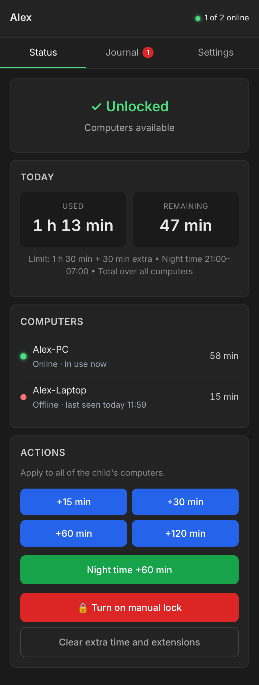
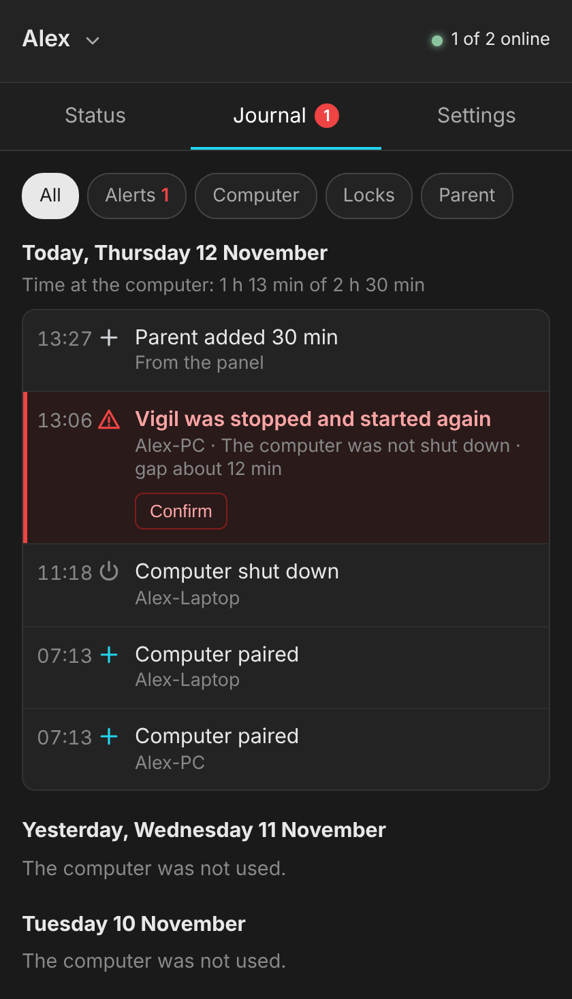
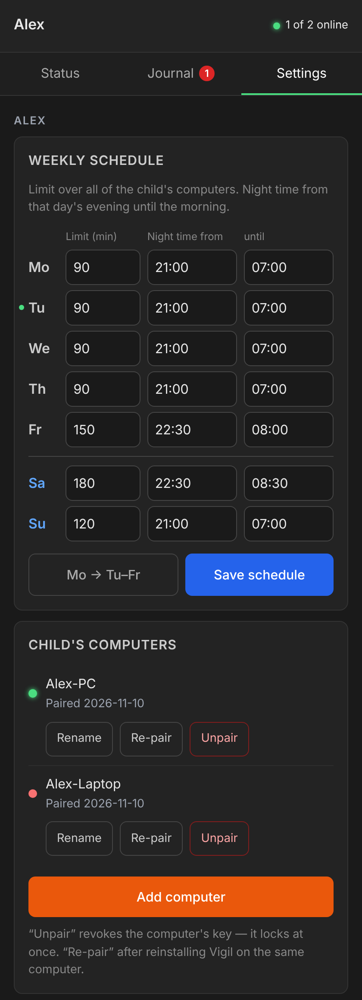
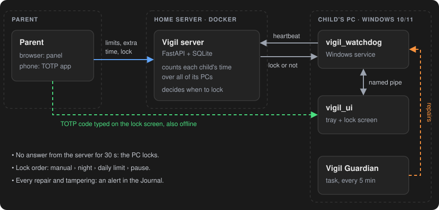

# Vigil

[](https://github.com/deresterr/vigil/actions/workflows/ci.yml)
[](https://github.com/deresterr/vigil/releases/latest)
[](LICENSE)

**English** · [Polski](README.pl.md)

Self-hosted screen-time control for a child's Windows 10/11 PC. A small server in Docker on your home network
counts the time and decides when to lock; a service on the child's PC shows a full-screen lock, and the parent
manages everything from a browser and unlocks with a TOTP code from their phone.

<p align="center">
  
  &nbsp;
  
  &nbsp;
  
</p>

> **Before 1.0, in daily use.** A child with administrator rights can get around Vigil. Vigil makes that harder
> and shows it to the parent; it does not make it impossible — see the [threat model](#threat-model).

## How it works

<p align="center">
  
</p>

- The service on the PC sends a signed heartbeat every few seconds (every second while locked).
- The server adds the time to the child — summed over all of the child's PCs — and decides whether to lock:
  manual lock, night time, daily limit or a pause, in that order.
- The service shows or removes the full-screen lock in the child's session.
- No answer from the server for 30 s means locked (fail-closed). The parent's TOTP code unlocks it even then.
- A guardian task puts back what keeps the service running; every repair and every other sign of tampering
  ends up as an alert in the parent panel.

Details: [`docs/architecture.md`](docs/architecture.md).

## Features

- Several children on one server, each with any number of PCs; time counts across all of them.
- Weekly schedule: a daily limit and night time for each day of the week and each child.
- Manual lock and extra time from the panel; extra time also with a TOTP code typed on the lock screen.
- Unlocking with the phone code works without a connection to the server.
- A pause the child starts from the tray: time is not counted, the screen is locked.
- Journal in the parent panel with alerts about attempts to get around Vigil, confirmed by the parent.
- Panel, lock screen and installer in English or Polish, following the browser and Windows language.
- The client is one file, `vigil_setup.exe`: a console wizard to install, a menu to check, update, re-pair or uninstall.

## Threat model

Vigil assumes the child **may have an administrator account** — that is how most families use their PCs.
An administrator can run code as SYSTEM, read any file and disable any service, so nothing on the PC itself is
tamper-proof. Every mechanism belongs to one of three groups.

**Protects** — holds even against an administrator, because the state lives on the server:
- limits, night time, the manual lock and the time counter are on the server; the PC cannot change them,
  only feed it false data (see "Does not detect"),
- PCs are paired with a one-time code from the panel; every pairing issues a new key and the previous PC
  loses access,
- a TOTP code works only once; after wrong codes unlocking pauses for minutes,
- a limit on login attempts to the parent panel.

**Impedes** — stops a process without administrator rights and casual attempts; an administrator gets past it:
- requests to the server are signed with a key in a file readable only by SYSTEM and administrators,
- no connection to the server = locked (fail-closed),
- a service an administrator cannot stop with a plain command; a guardian undoes disabling the service,
  replacing its file and other changes to the installation every 5 minutes; the service also runs in Safe Mode,
- the lock screen covers every monitor and blocks shortcuts (Win, Alt+Tab, Alt+F4); Task Manager and changing
  the account password are disabled — for the parent too, as it is the same account,
- the lock screen process cannot be closed without administrator rights; closing it repeatedly logs the user off,
- offline unlocking with the TOTP code: the secret is on the PC's disk and an administrator can read it.

**Detects** — an alert to confirm in the Journal:
- the service stopped, or restarted without a system restart,
- the service frozen or suspended while the computer was running,
- the lock screen closed repeatedly,
- every repair by the guardian (a disabled service, a replaced file, …),
- runs of wrong TOTP codes, failed panel logins, an invalidated pairing code.

**Does not detect:** a service stopped for good (the panel shows the PC as offline), a deleted or damaged
configuration on the PC (`vigil.toml`, `signing.dat`: the service does not start, offline as well), another system
booted from a USB stick (offline as well), or forged requests from an administrator who read the key from the disk.

**Network:** the server speaks plain HTTP. Requests and responses are signed, but the pairing response carries the
PC's key in the clear, and the panel password travels unencrypted too: whoever can read that traffic can act as
that PC or as the parent. On a network you do not trust, put a reverse proxy with TLS in front of the server.

What counts as a vulnerability under this model: [`SECURITY.md`](SECURITY.md).

## Quick start

You need a Linux host with Docker on the same network as the child's PC (or reachable over a VPN), and a TOTP
app on the parent's phone (Aegis, Google Authenticator, …).

**1. Server.** In an empty folder, create `compose.yaml`:

```yaml
services:
  vigil:
    image: ghcr.io/deresterr/vigil-server:latest   # or a version, e.g. :0.8.0
    container_name: vigil
    restart: unless-stopped
    ports:
      - "8088:8088"
    volumes:
      - ./data:/data        # the SQLite database: keep it in your backups
```

```bash
docker compose up -d
```

Open `http://<server-ip>:8088/setup` right away — the wizard is open without a login until it is completed:
the child's name, the parent password, TOTP, the time zone and the week (a limit and night time for each day,
also changed later in the panel: Settings → Weekly schedule).

**2. Child's PC.** Download [`vigil_setup.exe`](https://github.com/deresterr/vigil/releases/latest/download/vigil_setup.exe)
from the latest release and run it on the child's PC. It asks for administrator rights; a downloaded copy may
first get SmartScreen's "Windows protected your PC" (More info → Run anyway). The wizard asks for the server
address and a pairing code (panel: Settings → Child's computers → Add computer) and finds the child's account
itself. Nothing on the PC changes before you confirm the summary.

Run `vigil_setup.exe` again later for the status and the menu: check, update, change the server address,
re-pair, uninstall. Parameters for scripts: [`docs/installer.md`](docs/installer.md).

### Updating

- Server: `docker compose pull && docker compose up -d`. The database schema is updated at start; back up `data/` first.
- Child's PC: run the new `vigil_setup.exe` → **Update to …**. The address and the key stay.

### If Windows does not start or Vigil cannot be removed

For an ordinary lock the parent's TOTP code is enough, also offline — once the PC has reached the server
after its install (that is when it receives the secret). If the PC itself must be freed from outside
Windows: Windows Recovery → Troubleshoot → Command Prompt → `rmdir /s /q D:\ProgramData\Vigil` (the Windows
drive is often `D:` there; check with `dir D:\ProgramData`), restart, then uninstall from the menu and run
`vigil_setup.exe -Mode verify`. Without its files Vigil does not start, so there is no lock.
Step by step: [`docs/installer.md`](docs/installer.md#emergency-windows-does-not-start-or-vigil-cannot-be-removed-normally).

## Requirements

- **Server:** Docker on Linux. The release image is built for x86-64 (amd64); elsewhere build it from `server/`.
- **Child's PC:** Windows 10/11 x64, Home or Pro. The child's account is the only user account and may be an
  administrator; the parent maintains the PC from that same account.
- **Parent:** a browser and a TOTP app on the phone.

## Building from source

- Server: `cd server && cp .env.example .env && docker compose up -d` builds the image locally
  (`VIGIL_PORT` and the time zone of the logs in `.env`). Tests: `pip install -r requirements-dev.txt && ruff check . && pytest -q`.
- Client: Windows with the .NET 8 SDK (`winget install Microsoft.DotNet.SDK.8`), then `Build.cmd` →
  `dist\vigil_setup.exe`. The package is self-contained; the child's PC does not need .NET.

| Folder | Contents |
|---|---|
| `server/` | FastAPI + SQLite, parent panel, tests |
| `client/` | Windows service (`watchdog`), lock screen and tray (`ui`), installer and guardian (`setup`) |
| `e2e/` | installer end-to-end test, run in CI on a throwaway Windows runner |
| `docs/` | [architecture](docs/architecture.md), [installer](docs/installer.md), [guardian](docs/guardian.md), [design decisions](docs/decisions.md) |

Contributing: [`CONTRIBUTING.md`](CONTRIBUTING.md). Changes: [`CHANGELOG.md`](CHANGELOG.md).

## Security

Report vulnerabilities privately (Security → Report a vulnerability) — details in [`SECURITY.md`](SECURITY.md).

## License

MIT — see [`LICENSE`](LICENSE).
