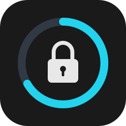
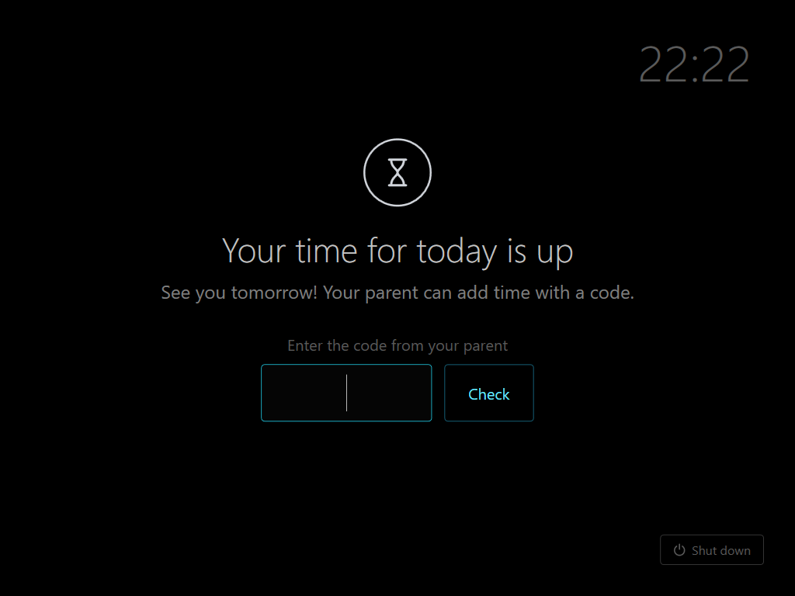
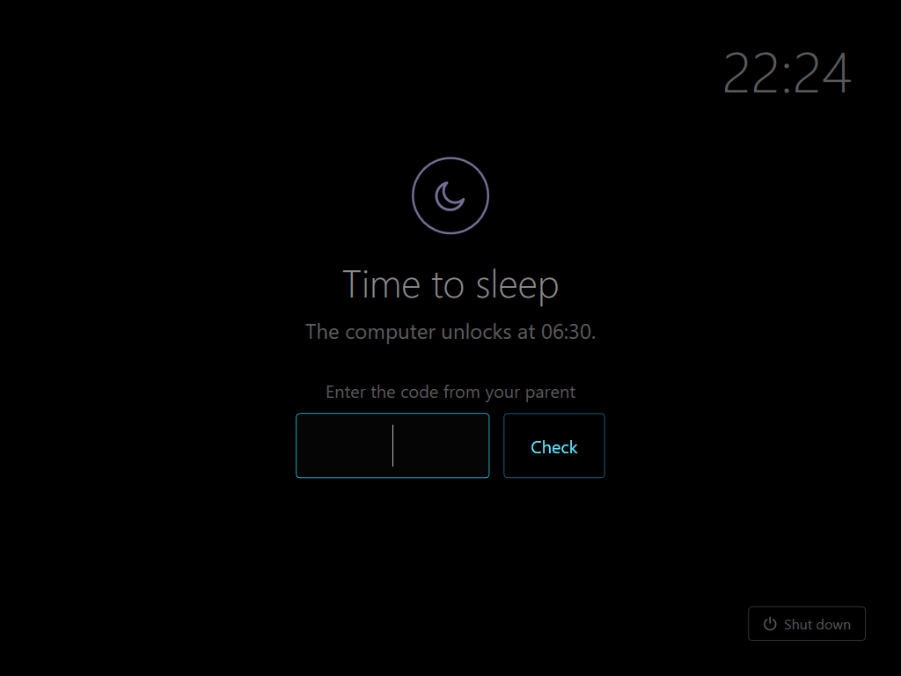

<p align="right">
  <b>English</b> · <a href="README.pl.md">Polski</a>
</p>

<p align="center">
  
</p>

<h1 align="center">Vigil</h1>

<p align="center">
  <b>Screen-time limits for a child's Windows PC, on your own server.</b><br>
  A daily limit and night time for each day of the week, a full-screen lock on the PC and a panel in your phone's
  browser. No cloud, no account, no subscription.
</p>

<p align="center">
  <a href="https://github.com/deresterr/vigil/releases/latest"></a>
  <a href="https://github.com/deresterr/vigil/actions/workflows/ci.yml"></a>
  <a href="LICENSE"></a>
</p>

<p align="center">
  <a href="#quick-start"><b>Quick start</b></a> ·
  <a href="https://github.com/deresterr/vigil/releases/latest"><b>Download</b></a> ·
  <a href="#how-it-works">How it works</a> ·
  <a href="docs/threat-model.md">Threat model</a>
</p>

<table align="center">
  <tr>
    <td align="center" valign="top" width="33%">
      <br>
      <sub><b>Status</b> — today's time, computers, extra time and the lock</sub>
    </td>
    <td align="center" valign="top" width="33%">
      <br>
      <sub><b>Journal</b> — what happened, with alerts to confirm</sub>
    </td>
    <td align="center" valign="top" width="33%">
      <br>
      <sub><b>Settings</b> — the week, children and their computers</sub>
    </td>
  </tr>
</table>

> [!NOTE]
> **Before 1.0, in daily use.** A child with administrator rights can get around Vigil: it makes that harder and
> shows it to the parent, but does not make it impossible. See [what Vigil can and cannot stop](#what-vigil-can-and-cannot-stop).

## Features

**For the parent**

- A daily limit and night time for each day of the week, for each child
- Several children on one server, each with any number of PCs; a child's time counts across all of them
- Extra time or a lock in one tap from the panel, or with the code from your phone typed on the lock screen
- The code from your phone unlocks the PC even when the server is down
- A journal: when each PC was on, asleep or shut down, what you changed, and an alert whenever someone tried to
  get around Vigil

**For the child**

- A lock screen that says why the PC is locked and when it unlocks
- A pause: a click on the tray icon stops the clock and locks the screen until they are back

**On the PC**

- One file, `vigil_setup.exe`, to install, check, update, re-pair and uninstall
- Windows 10 and 11, Home or Pro; the child's account may be an administrator
- English or Polish, following the browser's and Windows' language

## Quick start

You need a Linux machine with Docker on the same network as the child's PC (or reachable over a VPN), and a TOTP
app on your phone (Aegis, Google Authenticator, …).

### 1. Start the server

In an empty folder, create `compose.yaml`:

```yaml
services:
  vigil:
    image: ghcr.io/deresterr/vigil-server:latest   # or a version, e.g. :0.9.1
    container_name: vigil
    restart: unless-stopped
    ports:
      - "8088:8088"
    volumes:
      - ./data:/data        # the SQLite database: keep it in your backups
```

```bash
docker compose up -d
```

### 2. Set it up in the browser

Open `http://<server-ip>:8088/setup` right after the start — until the wizard is completed, anyone on the network
can open it. It asks for the child's name, your panel password, the TOTP app (scan the QR code), the time zone and
the week: a limit and night time for each day. You can change the week later in **Settings → Weekly schedule**.

### 3. Install on the child's PC

1. In the panel, open **Settings → Add computer** to get a pairing code.
2. On the child's PC, download
   [`vigil_setup.exe`](https://github.com/deresterr/vigil/releases/latest/download/vigil_setup.exe) and run it.
   It asks for administrator rights; SmartScreen may first show "Windows protected your PC" (More info → Run
   anyway).
3. Type the server address and the pairing code. The installer finds the child's account itself and changes
   nothing before you confirm the summary.

Run `vigil_setup.exe` again at any time for the status and a menu: check, update, change the server address,
re-pair, uninstall. Parameters for scripts: [`docs/installer.md`](docs/installer.md).

## How it works

<p align="center">
  
</p>

- Every few seconds the service on the PC sends the server a signed heartbeat (every second while locked).
- The server counts the child's time across all of their PCs and decides whether to lock: manual lock, night
  time, daily limit or pause, in that order.
- The service shows or removes the lock screen in the child's session.
- **No answer from the server for 30 seconds means locked.** The code from your phone still unlocks the PC; once
  the server answers again, it decides, and the minutes used offline do not count.
- A guardian task puts back whatever keeps the service running, and every repair is an alert in the panel.

<table align="center">
  <tr>
    <td align="center" valign="top" width="50%">
      <br>
      <sub>The time for today is up: the parent can add time with a code</sub>
    </td>
    <td align="center" valign="top" width="50%">
      <br>
      <sub>Night time: the lock says when the PC unlocks</sub>
    </td>
  </tr>
</table>

Protocol, time accounting and file paths: [`docs/architecture.md`](docs/architecture.md).

## What Vigil can and cannot stop

Most families give the child an administrator account, so Vigil assumes one. An administrator can disable any
service and read any file, so nothing on the PC itself is tamper-proof. What matters lives on the server, the rest
is made hard to undo, and the parent sees the attempts.

| | What it means | For example |
|---|---|---|
| **Protects** | Yes — the state is on the server | limits, night time, the lock and the time counter; one-time pairing codes; TOTP codes that work once |
| **Impedes** | No — stops programs without administrator rights and casual attempts | signed requests, locked without the server, a service that a plain command cannot stop, a guardian that undoes tampering, a lock screen over every monitor |
| **Detects** | An alert in the Journal for the parent to confirm | a stopped, frozen or restarted service, a lock screen closed repeatedly, every repair by the guardian, runs of wrong codes |

**Not detected:** a service stopped for good, a deleted configuration or another system booted from a USB stick —
the panel shows the PC as offline.

> [!IMPORTANT]
> The server speaks plain HTTP, and the pairing and the panel login send their secrets unencrypted. On a network
> you do not trust, put a reverse proxy with TLS in front of it ([Network](docs/threat-model.md#network)).

Every mechanism, group by group: [`docs/threat-model.md`](docs/threat-model.md). What counts as a vulnerability:
[`SECURITY.md`](SECURITY.md).

## Updating

| | How to update |
|---|---|
| **Server** | `docker compose pull && docker compose up -d`. The database is updated at start: back up `data/` first. |
| **Child's PC** | Run the new `vigil_setup.exe` → **Update to …**. The server address and the pairing stay. |

Each [release](https://github.com/deresterr/vigil/releases) says which of the two it needs.

## Troubleshooting

<details>
<summary><b>The PC is locked and the server is down</b></summary>

<br>

Type the code from your phone on the lock screen: it works offline once the PC has reached the server after its
install (that is when it receives the secret). When the server answers again, it decides as usual.

</details>

<details>
<summary><b>Windows does not start, or Vigil cannot be removed</b></summary>

<br>

Free the PC from outside Windows:

1. Windows Recovery → **Troubleshoot** → **Command Prompt**.
2. `rmdir /s /q D:\ProgramData\Vigil` — the Windows drive is often `D:` there; check with `dir D:\ProgramData`.
3. Restart. Without its files Vigil does not start, so there is no lock.
4. Uninstall from the `vigil_setup.exe` menu, then run `vigil_setup.exe -Mode verify`.

Step by step: [`docs/installer.md`](docs/installer.md#emergency-windows-does-not-start-or-vigil-cannot-be-removed-normally).

</details>

## Requirements

| | What you need |
|---|---|
| **Server** | Docker on Linux. The release image is for x86-64 (amd64); elsewhere build it from `server/`. |
| **Child's PC** | Windows 10 or 11, x64, Home or Pro. The child's account is the only user account and may be an administrator; the parent maintains the PC from that same account. |
| **Parent** | A browser and a TOTP app on the phone. |

## Development

The server is Python 3.12 (FastAPI, SQLite), the client .NET 10.

- **Server:** `cd server && cp .env.example .env && docker compose up -d` builds the image locally. Tests:
  `pip install -r requirements-dev.txt && ruff check . && pytest -q`.
- **Client:** on Windows with the .NET 10 SDK (`winget install Microsoft.DotNet.SDK.10`), run `Build.cmd` →
  `dist\vigil_setup.exe`. The package is self-contained: the child's PC does not need .NET.

| Folder | Contents |
|---|---|
| `server/` | FastAPI + SQLite, the parent panel, tests |
| `client/` | Windows service (`watchdog`), lock screen and tray (`ui`), installer and guardian (`setup`) |
| `e2e/` | installer end-to-end test, run in CI on a throwaway Windows runner |
| `docs/` | [architecture](docs/architecture.md), [threat model](docs/threat-model.md), [installer](docs/installer.md), [guardian](docs/guardian.md), [design decisions](docs/decisions.md), [releasing](docs/releasing.md) |

Contributing: [`CONTRIBUTING.md`](CONTRIBUTING.md) · Changes: [`CHANGELOG.md`](CHANGELOG.md) · Vulnerabilities:
privately via **Security → Report a vulnerability** ([`SECURITY.md`](SECURITY.md)).

## License

MIT — see [`LICENSE`](LICENSE).
