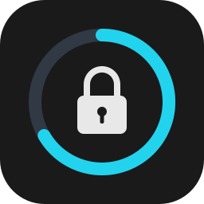
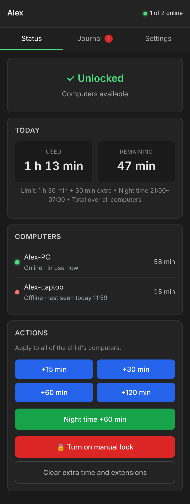
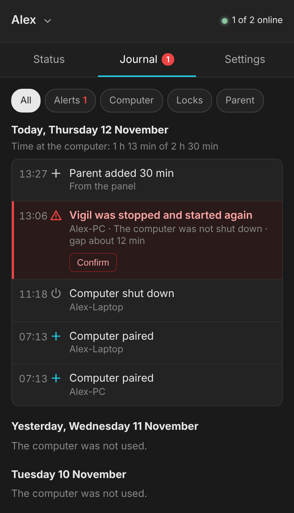
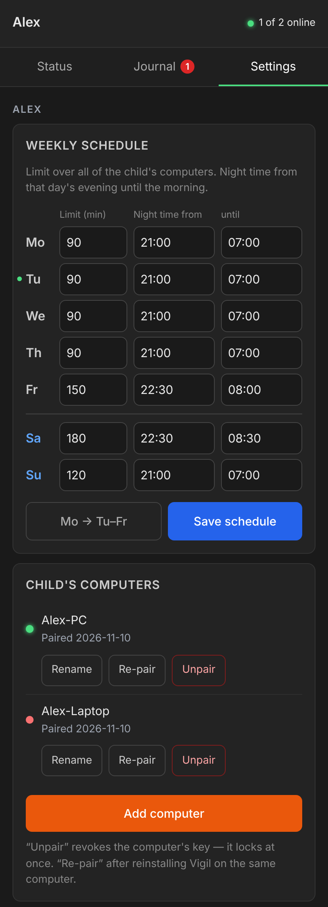

<p align="center">
  
</p>

<h1 align="center">Vigil</h1>

<p align="center">
  <b>Limity czasu przy komputerze z Windows dla dziecka, na własnym serwerze.</b><br>
  Dzienny limit i cisza nocna na każdy dzień tygodnia, pełnoekranowa blokada na PC i panel w przeglądarce
  telefonu. Bez chmury, bez konta, bez abonamentu.
</p>

<p align="center">
  <a href="https://github.com/deresterr/vigil/releases/latest"></a>
  <a href="https://github.com/deresterr/vigil/actions/workflows/ci.yml"></a>
  <a href="LICENSE"></a>
</p>

<p align="center">
  <a href="#szybki-start"><b>Szybki start</b></a> ·
  <a href="https://github.com/deresterr/vigil/releases/latest"><b>Pobierz</b></a> ·
  <a href="#jak-to-działa">Jak to działa</a> ·
  <a href="docs/threat-model.pl.md">Model zagrożeń</a> ·
  <a href="README.md">English</a>
</p>

<table align="center">
  <tr>
    <td align="center" valign="top" width="33%">
      <br>
      <sub><b>Stan</b> — dzisiejszy czas, komputery, dodatkowy czas i blokada</sub>
    </td>
    <td align="center" valign="top" width="33%">
      <br>
      <sub><b>Dziennik</b> — co się działo, z alertami do potwierdzenia</sub>
    </td>
    <td align="center" valign="top" width="33%">
      <br>
      <sub><b>Ustawienia</b> — tydzień, dzieci i ich komputery</sub>
    </td>
  </tr>
</table>

> [!NOTE]
> **Przed wersją 1.0, w codziennym użyciu.** Dziecko z uprawnieniami administratora jest w stanie Vigila obejść:
> Vigil to utrudnia i pokazuje rodzicowi, ale nie uniemożliwia. Patrz [co Vigil zatrzyma, a czego nie](#co-vigil-zatrzyma-a-czego-nie).

## Co potrafi

**Dla rodzica**

- Dzienny limit i cisza nocna na każdy dzień tygodnia, osobno dla każdego dziecka
- Kilkoro dzieci na jednym serwerze, każde z dowolną liczbą komputerów; czas dziecka liczy się łącznie ze wszystkich
- Dodatkowy czas albo blokada jednym dotknięciem w panelu albo kodem z telefonu wpisanym na ekranie blokady
- Kod z telefonu odblokowuje PC także wtedy, gdy serwer nie działa
- Dziennik: kiedy każdy komputer był włączony, uśpiony albo wyłączony, zmiany rodzica i alert przy każdej
  próbie obejścia Vigila

**Dla dziecka**

- Ekran blokady, który mówi, dlaczego komputer jest zablokowany i kiedy się odblokuje
- Pauza: kliknięcie ikony w zasobniku zatrzymuje czas i blokuje ekran do powrotu

**Na komputerze**

- Jeden plik, `vigil_setup.exe`, do instalacji, sprawdzenia, aktualizacji, ponownego parowania i odinstalowania
- Windows 10 i 11, Home albo Pro; konto dziecka może mieć uprawnienia administratora
- Po polsku albo angielsku, według języka przeglądarki i Windows

## Szybki start

Potrzebny jest Linux z Dockerem w tej samej sieci co PC dziecka (albo osiągalny przez VPN) i aplikacja TOTP
w telefonie (Aegis, Google Authenticator, …).

### 1. Uruchom serwer

W pustym katalogu utwórz `compose.yaml`:

```yaml
services:
  vigil:
    image: ghcr.io/deresterr/vigil-server:latest   # albo konkretna wersja, np. :0.9.1
    container_name: vigil
    restart: unless-stopped
    ports:
      - "8088:8088"
    volumes:
      - ./data:/data        # baza SQLite: uwzględnij ją w kopiach zapasowych
```

```bash
docker compose up -d
```

### 2. Skonfiguruj w przeglądarce

Od razu po starcie otwórz `http://<ip-serwera>:8088/setup` — dopóki kreator nie zostanie ukończony, może go
otworzyć każdy w sieci. Pyta o imię dziecka, hasło do panelu, aplikację TOTP (zeskanuj kod QR), strefę czasową
i tydzień: limit i ciszę nocną na każdy dzień. Tydzień zmienisz potem w **Ustawienia → Harmonogram tygodnia**.

### 3. Zainstaluj na PC dziecka

1. W panelu otwórz **Ustawienia → Dodaj komputer**, żeby dostać kod parowania.
2. Na PC dziecka pobierz
   [`vigil_setup.exe`](https://github.com/deresterr/vigil/releases/latest/download/vigil_setup.exe) i uruchom go.
   Prosi o uprawnienia administratora; SmartScreen może najpierw pokazać „System Windows ochronił ten komputer”
   (Więcej informacji → Uruchom mimo to).
3. Wpisz adres serwera i kod parowania. Instalator sam znajduje konto dziecka i niczego nie zmienia, zanim nie
   potwierdzisz podsumowania.

Uruchom `vigil_setup.exe` jeszcze raz w dowolnym momencie, żeby zobaczyć stan i menu: sprawdzenie, aktualizacja,
zmiana adresu serwera, ponowne parowanie, odinstalowanie. Parametry do skryptów (po angielsku):
[`docs/installer.md`](docs/installer.md).

## Jak to działa

<p align="center">
  
</p>

- Co kilka sekund usługa na PC wysyła serwerowi podpisany heartbeat (w czasie blokady co sekundę).
- Serwer liczy czas dziecka łącznie ze wszystkich jego komputerów i decyduje o blokadzie: blokada ręczna, cisza
  nocna, dzienny limit albo pauza, w tej kolejności.
- Usługa pokazuje albo zdejmuje ekran blokady w sesji dziecka.
- **Brak odpowiedzi serwera przez 30 sekund oznacza blokadę.** Kod z telefonu nadal odblokowuje PC; gdy serwer
  znów odpowie, decyduje on, a minuty użyte offline nie są liczone.
- Zadanie strażnika przywraca to, co utrzymuje usługę przy życiu, a każda naprawa to alert w panelu.

<table align="center">
  <tr>
    <td align="center" valign="top" width="50%">
      <br>
      <sub>Czas na dziś się skończył: rodzic może dodać czas kodem</sub>
    </td>
    <td align="center" valign="top" width="50%">
      <br>
      <sub>Cisza nocna: blokada mówi, kiedy PC się odblokuje</sub>
    </td>
  </tr>
</table>

Protokół, liczenie czasu i ścieżki plików (po angielsku): [`docs/architecture.md`](docs/architecture.md).

## Co Vigil zatrzyma, a czego nie

Większość rodzin daje dziecku konto administratora, więc Vigil to zakłada. Administrator może wyłączyć każdą
usługę i odczytać każdy plik, więc na samym PC nic nie jest odporne na manipulację. To, co ważne, jest na
serwerze, resztę trudno odkręcić, a rodzic widzi próby.

| | Co to znaczy | Na przykład |
|---|---|---|
| **Chroni** | Działa także przeciw administratorowi — stan jest na serwerze | limity, cisza nocna, blokada i licznik czasu; jednorazowe kody parowania; kody TOTP działające raz |
| **Utrudnia** | Zatrzymuje programy bez uprawnień administratora i przypadkowe próby | podpisane żądania, blokada bez serwera, usługa, której nie zatrzyma zwykłe polecenie, strażnik cofający manipulacje, ekran blokady na każdym monitorze |
| **Wykrywa** | Alert w Dzienniku do potwierdzenia przez rodzica | zatrzymana, zamrożona albo ponownie uruchomiona usługa, wielokrotnie zamykany ekran blokady, każda naprawa strażnika, serie błędnych kodów |

**Nie wykrywa:** usługi zatrzymanej na stałe, usuniętej konfiguracji ani innego systemu uruchomionego
z pendrive'a — panel pokazuje wtedy PC jako offline.

> [!IMPORTANT]
> Serwer mówi zwykłym HTTP, a parowanie i logowanie do panelu wysyłają swoje sekrety niezaszyfrowane. W sieci,
> której nie ufasz, postaw przed nim reverse proxy z TLS ([Sieć](docs/threat-model.pl.md#sieć)).

Każdy mechanizm, grupa po grupie: [`docs/threat-model.pl.md`](docs/threat-model.pl.md). Co jest podatnością:
[`SECURITY.pl.md`](SECURITY.pl.md).

## Aktualizacja

| | Jak zaktualizować |
|---|---|
| **Serwer** | `docker compose pull && docker compose up -d`. Baza aktualizuje się przy starcie: najpierw zrób kopię `data/`. |
| **PC dziecka** | Uruchom nowy `vigil_setup.exe` → **Zaktualizuj do …**. Adres serwera i parowanie zostają. |

Każde [wydanie](https://github.com/deresterr/vigil/releases) mówi, której z tych dwóch części wymaga.

## Rozwiązywanie problemów

<details>
<summary><b>PC jest zablokowany, a serwer nie działa</b></summary>

<br>

Wpisz kod z telefonu na ekranie blokady: działa offline, gdy PC choć raz połączył się z serwerem po instalacji
(wtedy dostaje sekret). Gdy serwer znów odpowie, decyduje jak zwykle.

</details>

<details>
<summary><b>Windows się nie uruchamia albo Vigila nie da się usunąć</b></summary>

<br>

Uwolnij PC spoza Windows:

1. Środowisko odzyskiwania → **Rozwiązywanie problemów** → **Wiersz polecenia**.
2. `rmdir /s /q D:\ProgramData\Vigil` — dysk z Windows ma tam często literę `D:`; sprawdź `dir D:\ProgramData`.
3. Uruchom ponownie. Bez swoich plików Vigil się nie uruchomi, więc nie ma blokady.
4. Odinstaluj z menu `vigil_setup.exe`, potem uruchom `vigil_setup.exe -Mode verify`.

Krok po kroku (po angielsku): [`docs/installer.md`](docs/installer.md#emergency-windows-does-not-start-or-vigil-cannot-be-removed-normally).

</details>

## Wymagania

| | Co jest potrzebne |
|---|---|
| **Serwer** | Docker na Linuksie. Obraz z wydania jest dla x86-64 (amd64); na innych architekturach zbuduj go z `server/`. |
| **PC dziecka** | Windows 10 albo 11, x64, Home albo Pro. Konto dziecka jest jedynym kontem użytkownika i może mieć uprawnienia administratora; rodzic obsługuje PC z tego samego konta. |
| **Rodzic** | Przeglądarka i aplikacja TOTP w telefonie. |

## Rozwój

Serwer to Python 3.12 (FastAPI, SQLite), klient — .NET 10.

- **Serwer:** `cd server && cp .env.example .env && docker compose up -d` buduje obraz lokalnie. Testy:
  `pip install -r requirements-dev.txt && ruff check . && pytest -q`.
- **Klient:** na Windows z .NET 10 SDK (`winget install Microsoft.DotNet.SDK.10`) uruchom `Build.cmd` →
  `dist\vigil_setup.exe`. Paczka jest samowystarczalna: PC dziecka nie potrzebuje .NET.

| Katalog | Zawartość |
|---|---|
| `server/` | FastAPI + SQLite, panel rodzica, testy |
| `client/` | usługa Windows (`watchdog`), ekran blokady i zasobnik (`ui`), instalator i strażnik (`setup`) |
| `e2e/` | test end-to-end instalatora, uruchamiany w CI na jednorazowym Windows |
| `docs/` | (po angielsku) [architektura](docs/architecture.md), [model zagrożeń](docs/threat-model.pl.md) (też po polsku), [instalator](docs/installer.md), [strażnik](docs/guardian.md), [decyzje projektowe](docs/decisions.md), [wydania](docs/releasing.md) |

Współpraca (po angielsku): [`CONTRIBUTING.md`](CONTRIBUTING.md) · Zmiany: [`CHANGELOG.md`](CHANGELOG.md) ·
Podatności: prywatnie przez **Security → Report a vulnerability** ([`SECURITY.pl.md`](SECURITY.pl.md)).

## Licencja

MIT — patrz [`LICENSE`](LICENSE).
