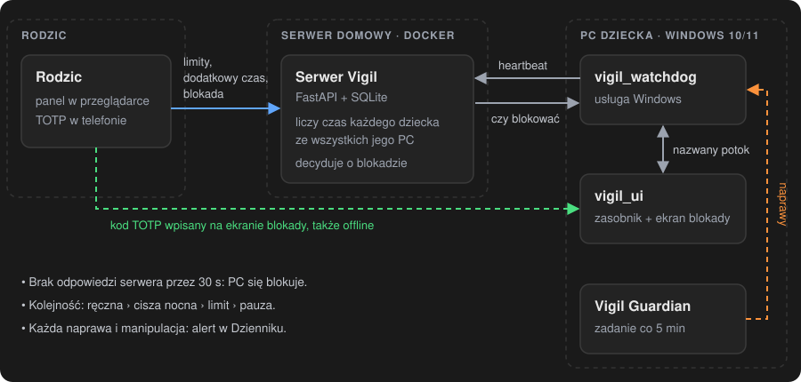
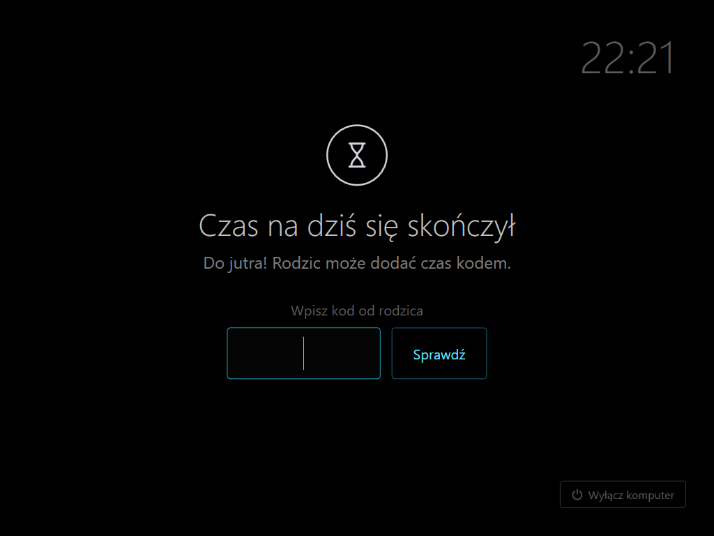
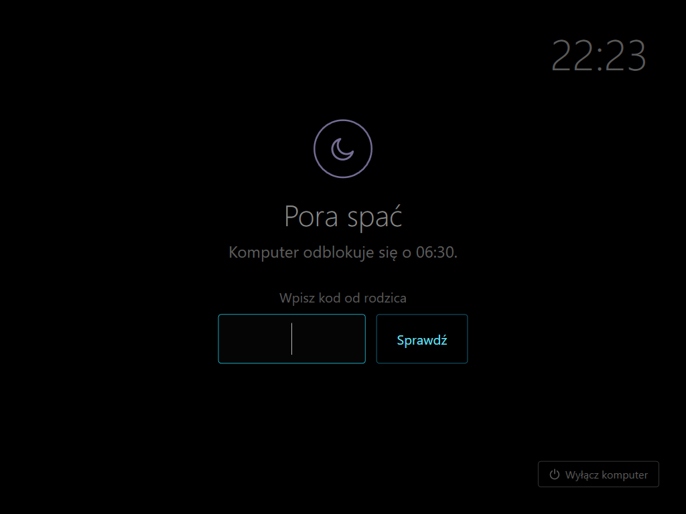

# Vigil

[](https://github.com/deresterr/vigil/actions/workflows/ci.yml)
[](https://github.com/deresterr/vigil/releases/latest)
[](LICENSE)

[English](README.md) · **Polski**

Samodzielnie hostowana kontrola czasu dziecka przy komputerze z Windows 10/11. Mały serwer w Dockerze w domowej
sieci liczy czas i decyduje o blokadzie; usługa na PC dziecka pokazuje pełnoekranową blokadę, a rodzic zarządza
wszystkim z przeglądarki i odblokowuje kodem TOTP z telefonu.

<p align="center">
  
  &nbsp;
  
  &nbsp;
  
</p>

> **Przed wersją 1.0, w codziennym użyciu.** Dziecko z uprawnieniami administratora jest w stanie Vigila obejść.
> Vigil ma to utrudnić i pokazać rodzicowi, nie uniemożliwić — patrz [model zagrożeń](#model-zagrożeń).

## Jak to działa

<p align="center">
  
</p>

- Usługa na PC co kilka sekund (w czasie blokady co sekundę) wysyła podpisany heartbeat.
- Serwer dolicza czas dziecku — łącznie ze wszystkich jego komputerów — i decyduje o blokadzie: blokada ręczna,
  cisza nocna, dzienny limit albo pauza, w tej kolejności.
- Usługa pokazuje albo zdejmuje pełnoekranową blokadę w sesji dziecka.
- Brak odpowiedzi serwera przez 30 s oznacza blokadę (fail-closed). Kod TOTP rodzica odblokowuje i wtedy,
  do powrotu połączenia: od tej chwili decyduje serwer, a minuty użyte offline nie są liczone.
- Zadanie strażnika przywraca to, co utrzymuje usługę przy życiu; każda naprawa i każdy inny ślad manipulacji
  trafia jako alert do panelu rodzica.

<p align="center">
  
  &nbsp;
  
</p>

Szczegóły (po angielsku): [`docs/architecture.md`](docs/architecture.md).

## Co potrafi

- Kilkoro dzieci na jednym serwerze, każde z dowolną liczbą komputerów; czas liczy się łącznie.
- Harmonogram tygodnia: dzienny limit (0 = bez limitu) i cisza nocna osobno dla każdego dnia tygodnia i każdego dziecka.
- Blokada ręczna i dodatkowy czas z panelu; dodatkowy czas także kodem TOTP wpisanym na ekranie blokady.
- Odblokowanie kodem z telefonu działa bez połączenia z serwerem.
- Pauza uruchamiana przez dziecko z zasobnika: czas nie leci, ekran jest zablokowany.
- Dziennik w panelu rodzica: kiedy każdy komputer był włączony, uśpiony albo wyłączony, co zmienił rodzic,
  i alerty o próbach obejścia Vigila, potwierdzane przez rodzica.
- Panel, ekran blokady i instalator po polsku albo angielsku — według języka przeglądarki i Windows.
- Klient to jeden plik, `vigil_setup.exe`: kreator w konsoli do instalacji, menu do sprawdzenia, aktualizacji,
  ponownego parowania i odinstalowania.

## Model zagrożeń

Vigil zakłada, że dziecko **może mieć konto administratora** — tak korzysta z komputera większość rodzin.
Administrator może uruchomić kod jako SYSTEM, odczytać każdy plik i wyłączyć każdą usługę, więc na samym PC
nic nie jest odporne na manipulację. Każdy mechanizm należy do jednej z trzech grup.

**Chroni** — działa także przeciw administratorowi, bo stan jest na serwerze:
- limity, cisza nocna, blokada ręczna i licznik czasu są na serwerze; z PC nie da się ich zmienić,
  można najwyżej podsunąć fałszywe dane (patrz „Nie wykrywa”),
- parowanie PC jednorazowym kodem z panelu; każde parowanie wydaje nowy klucz, poprzedni PC traci dostęp,
- kod TOTP działa tylko raz; po błędnych kodach odblokowanie wstrzymuje się na minuty,
- limit prób logowania do panelu rodzica.

**Utrudnia** — zatrzymuje proces bez uprawnień administratora i przypadkowe próby; administrator to obejdzie:
- żądania do serwera podpisane kluczem z pliku dostępnego tylko dla SYSTEM i administratorów,
- brak połączenia z serwerem = blokada (fail-closed),
- usługi administrator nie zatrzyma zwykłym poleceniem; strażnik co 5 minut cofa wyłączenie usługi, podmianę
  jej pliku i inne zmiany w instalacji; usługa działa też w trybie awaryjnym,
- ekran blokady zakrywa wszystkie monitory i blokuje skróty (Win, Alt+Tab, Alt+F4); Menedżer zadań i zmiana
  hasła konta są wyłączone — także dla rodzica, bo to to samo konto,
- procesu ekranu blokady nie da się zamknąć bez uprawnień administratora; wielokrotne zamykanie wylogowuje użytkownika,
- odblokowanie offline kodem TOTP: sekret jest na dysku PC i administrator może go odczytać.

**Wykrywa** — alert do potwierdzenia w Dzienniku:
- zatrzymanie usługi albo jej ponowne uruchomienie bez restartu systemu,
- zamrożenie lub wstrzymanie usługi przy działającym komputerze,
- wielokrotne zamykanie ekranu blokady,
- każdą naprawę strażnika (wyłączona usługa, podmieniony plik, …),
- serie błędnych kodów TOTP, nieudane logowania do panelu, unieważniony kod parowania.

**Nie wykrywa:** trwałego zatrzymania usługi (panel pokazuje PC jako offline), usuniętej lub uszkodzonej
konfiguracji na PC (`vigil.toml`, `signing.dat`: usługa nie startuje, też offline), uruchomienia innego systemu
z pendrive'a (też offline) ani sfałszowanych żądań od administratora, który odczytał klucz z dysku.

**Sieć:** serwer mówi zwykłym HTTP. Żądania i odpowiedzi są podpisane, ale odpowiedź parowania niesie klucz PC
jawnym tekstem, a hasło do panelu też idzie niezaszyfrowane: kto może czytać ten ruch, może podszyć się pod ten PC
albo pod rodzica. W sieci, której nie ufasz, postaw przed serwerem reverse proxy z TLS i podaj w `vigil_setup.exe`
jego adres `https://`: Vigil nie idzie za przekierowaniami, nie używa proxy systemowego, a certyfikat musi być
zaufany przez Windows.

Co w tym modelu jest podatnością: [`SECURITY.pl.md`](SECURITY.pl.md).

## Szybki start

Potrzebny jest Linux z Dockerem w tej samej sieci co PC dziecka (albo osiągalny przez VPN) i aplikacja TOTP
w telefonie rodzica (Aegis, Google Authenticator, …).

**1. Serwer.** W pustym katalogu utwórz `compose.yaml`:

```yaml
services:
  vigil:
    image: ghcr.io/deresterr/vigil-server:latest   # albo konkretna wersja, np. :0.9.1
    container_name: vigil
    restart: unless-stopped
    ports:
      - "8088:8088"
    volumes:
      - ./data:/data        # baza SQLite: uwzględnij ją w kopiach zapasowych
```

```bash
docker compose up -d
```

Od razu otwórz `http://<ip-serwera>:8088/setup` — kreator jest dostępny bez logowania, dopóki nie zostanie
ukończony: imię dziecka, hasło rodzica, TOTP, strefa czasowa i tydzień (limit i cisza nocna na każdy dzień,
zmienisz je też potem w panelu: Ustawienia → Harmonogram tygodnia).

**2. PC dziecka.** Pobierz [`vigil_setup.exe`](https://github.com/deresterr/vigil/releases/latest/download/vigil_setup.exe)
z najnowszego wydania i uruchom go na PC dziecka. Prosi o uprawnienia administratora; pobrana kopia może najpierw
dostać od SmartScreen „System Windows ochronił ten komputer” (Więcej informacji → Uruchom mimo to). Kreator pyta
o adres serwera i kod parowania (panel: Ustawienia → Dodaj komputer), a konto dziecka znajduje
sam. Nic na PC się nie zmienia, zanim nie potwierdzisz podsumowania.

Uruchom `vigil_setup.exe` później jeszcze raz, żeby zobaczyć stan i menu: sprawdzenie, aktualizacja, zmiana adresu
serwera, ponowne parowanie, odinstalowanie. Parametry do skryptów (po angielsku): [`docs/installer.md`](docs/installer.md).

### Aktualizacja

- Serwer: `docker compose pull && docker compose up -d`. Schemat bazy aktualizuje się przy starcie; najpierw zrób kopię `data/`.
- PC dziecka: uruchom nowy `vigil_setup.exe` → **Zaktualizuj do …**. Adres i klucz zostają.

### Gdy Windows się nie uruchamia albo Vigila nie da się usunąć

Na zwykłą blokadę wystarczy kod TOTP rodzica, także offline — gdy PC choć raz połączył się z serwerem
po instalacji (wtedy dostaje sekret). Jeśli sam PC trzeba uwolnić spoza Windows:
Środowisko odzyskiwania → Rozwiązywanie problemów → Wiersz polecenia → `rmdir /s /q D:\ProgramData\Vigil`
(dysk z Windows ma tam często literę `D:`; sprawdź `dir D:\ProgramData`), restart, potem odinstalowanie z menu
i `vigil_setup.exe -Mode verify`. Bez swoich plików Vigil się nie uruchomi, więc nie ma blokady.
Krok po kroku (po angielsku): [`docs/installer.md`](docs/installer.md#emergency-windows-does-not-start-or-vigil-cannot-be-removed-normally).

## Wymagania

- **Serwer:** Docker na Linuksie. Obraz z wydania jest zbudowany dla x86-64 (amd64); na innych architekturach zbuduj go z `server/`.
- **PC dziecka:** Windows 10/11 x64, Home albo Pro. Konto dziecka jest jedynym kontem użytkownika i może mieć
  uprawnienia administratora; rodzic obsługuje PC z tego samego konta.
- **Rodzic:** przeglądarka i aplikacja TOTP w telefonie.

## Budowanie ze źródeł

- Serwer: `cd server && cp .env.example .env && docker compose up -d` buduje obraz lokalnie
  (`VIGIL_PORT` i strefa czasowa logów w `.env`). Testy: `pip install -r requirements-dev.txt && ruff check . && pytest -q`.
- Klient: Windows z .NET 10 SDK (`winget install Microsoft.DotNet.SDK.10`), potem `Build.cmd` →
  `dist\vigil_setup.exe`. Paczka jest samowystarczalna; PC dziecka nie potrzebuje .NET.

| Katalog | Zawartość |
|---|---|
| `server/` | FastAPI + SQLite, panel rodzica, testy |
| `client/` | usługa Windows (`watchdog`), ekran blokady i zasobnik (`ui`), instalator i strażnik (`setup`) |
| `e2e/` | test end-to-end instalatora, uruchamiany w CI na jednorazowym Windows |
| `docs/` | (po angielsku) [architektura](docs/architecture.md), [instalator](docs/installer.md), [strażnik](docs/guardian.md), [decyzje projektowe](docs/decisions.md) |

Współpraca (po angielsku): [`CONTRIBUTING.md`](CONTRIBUTING.md). Zmiany: [`CHANGELOG.md`](CHANGELOG.md).

## Bezpieczeństwo

Podatności zgłaszaj prywatnie (Security → Report a vulnerability) — szczegóły w [`SECURITY.pl.md`](SECURITY.pl.md).

## Licencja

MIT — patrz [`LICENSE`](LICENSE).
